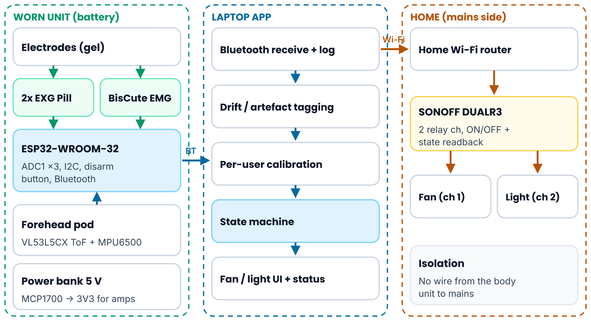
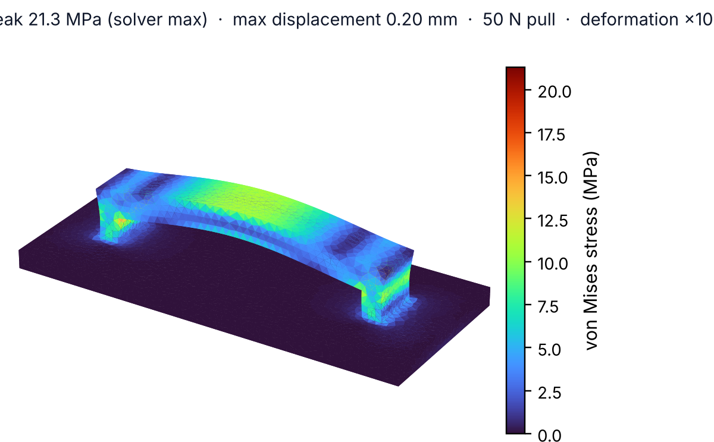

# VergeLink

**Camera-free eye-vergence + jaw-clench control of a fan and a light for people with quadriplegia.**
Vishwakarma Awards 2026-27 — Stage 2 submission.

VergeLink lets a person who can still move their eyes and jaw switch their own fan and light. The user looks at a FAN or LIGHT target. Two-channel EOG (eye direction + vergence) and a ToF depth sensor must agree on one target. A deliberate jaw clench (EMG) confirms it, and a SONOFF DUALR3 relay switches the appliance over home Wi-Fi.

## Status (14 Oct 2026)

| Item | Status |
|---|---|
| Parts | All ordered from Indian sellers by 6 Oct 2026 (₹13,093.27 of a ₹16,000 cap); delivery inventory in progress |
| Enclosure CAD | 12-part FreeCAD 1.1 assembly + STEP export — done |
| Mechanical FEA | CalculiX, strap loop, 50 N pull: peak von Mises 21.3 MPa, max displacement 0.20 mm — done |
| Schematic | KiCad 10, Rev A, ERC 0 errors / 0 warnings — done |
| PCB layout | Not started (build is on a 3×4 in perfboard) |
| Firmware / laptop app | Not started |
| Bench measurements | Not yet — all performance figures in the deck are **design targets** |

## Repository layout

| Folder | Contents |
|---|---|
| `presentation/` | Stage 2 deck (`.pptx`) and PDF copy |
| `cad/` | `VergeLink_Enclosure.FCStd` (native), `VergeLink_Enclosure.step`, `VergeLink_StrapLoop_FEA.FCStd` (mesh, constraints, CalculiX results), `fea_surface_results.json` (exported surface stresses used for the plot) |
| `kicad/` | KiCad 10 project: `.kicad_pro`, `.kicad_sch`, netlist, BOM, ERC report, schematic PDF |
| `figures/` | All figures used in the deck, produced for this project; no third-party images |

## Hardware (as ordered)

| Function | Part |
|---|---|
| Eye signals (L / R EOG) | 2 × Upside Down Labs BioAmp EXG Pill |
| Jaw-clench EMG | Upside Down Labs Muscle BioAmp BisCute |
| Controller | ESP32-WROOM-32 DevKit (ADC1: GPIO34/35/36; I2C: GPIO21/22) |
| Depth | ST VL53L5CX 8×8 ToF breakout |
| Head motion | MPU6500 (GY-6500), 6-axis — no magnetometer |
| Analog rail | MCP1700T-3302E/TT LDO (bio-amps only) |
| Appliances | SONOFF DUALR3, two channels (fan, light) |
| Power | 10,000 mAh USB power bank |

## Mechanical FEA summary

Strap loop (30 × 6 × 6 mm, 2 mm posts, 3 mm bridge) on a 2.2 mm PETG wall patch. Wall face fixed; 50 N pull on the bridge, away from the case. 44,420-node second-order tetrahedral mesh; E = 2.1 GPa, ν = 0.38.
Result: peak von Mises 21.3 MPa at the sharp inner bridge/post corner; max displacement 0.20 mm. Against typical PETG datasheet yield (~45–50 MPa) the bulk factor of safety is about 2.1–2.3. Next step: 1 mm fillet at that corner, and print with layers along the load path.

## Safety

Not a medical device; no certification is claimed.
- Electrodes are worn only while the unit runs from its battery — never while USB is connected to a mains-powered computer.
- The body-worn unit has no wired path to mains; commands reach the relay only over Wi-Fi.
- The relay is installed by a licensed electrician; the wall switches and the fan regulator stay in service.
- Volunteer testing happens only with institutional approval.

## Team

Dept. of Biomedical Engineering, Velalar College of Engineering and Technology (VCET), Erode — Batch 23BM7A.
Faculty guide: Mrs. C. Radhika. Industry mentor: K. P. Amalnath (Mediowel Healthineers).

## Key references

- Zhang X. et al., *VergeIO: Depth-Aware Eye Interaction on Glasses*, arXiv:2507.02187 (2025)
- Upside Down Labs — BioAmp EXG Pill and Muscle BioAmp BisCute documentation
- STMicroelectronics — VL53L5CX product documentation
- Espressif — ESP-IDF ADC documentation (ESP32)

The full reference list is on the last slide of the deck.
